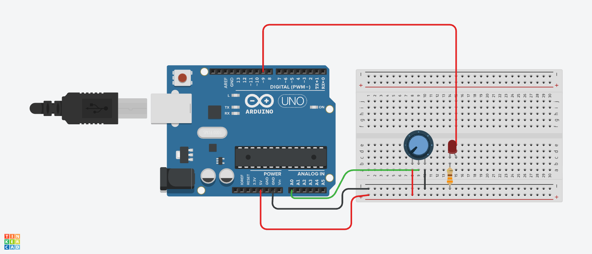

# Lab: Potentiometer
In this lab, you'll connect a potentiometer to your Arduino, read its value, and use it to control an LED.

## 1. Understand the potentiometer
A potentiometer is a variable resistor that allows you to control an electrical signal by turning a knob. Unlike a pushbutton, which has two states (HIGH or LOW), a potentiometer provides a continuous range of values.

A potentiometer has three terminals. The middle terminal is called the wiper and provides a variable voltage as you turn the knob.


## 2. Build the circuit
You will need the following components:
- Arduino Uno R3
- Breadboard
- 10kΩ potentiometer
- LED
- 330Ω resistor
- Jumper wires

### Wiring
| Component |	Arduino connection |
| --- | --- |
| Potentiometer (outer terminal 1)	| 5V |
| Potentiometer (outer terminal 2)	| GND |
| Potentiometer (middle terminal - wiper)	| A0 |
| LED anode (+)	| Digital pin 9  |
| LED cathode (−)  |	GND through 330Ω resistor |

Use the diagram below to support you.



## 3. Read the potentiometer
Upload the pot.ino sketch to the Arduino. Open the Serial monitor and read the values. Turn the potentionmeter knob.

## Reflect
1. What is the lowest and highest values you observe?
    > your answer

2. Do some research. Why does `analogRead()` return values from 0 - 1023 instead of 0 - 255?

## 4. Change the LED brightness
Pin 9 supports PWM (Pulse Width Modulation), which lets us simulate different brightness levels by rapidly switching the LED on and off. 
Any pin with a ~ (tilde) supports PWM.

Add the following lines of code in the `loop()` function under the `analogRead()` and before the `Serial.println()`.

```c++
int brightness = map(potValue, 0, 1023, 0, 255);
analogWrite(ledPin, brightness);
```

The `map()` function converts a number from one range into another. Here we are turning 0 - 1023, into 0 - 255.

### Reflect
1. Write a call to `map()` that converts the the variable `score` from the range 0 - 20, to 0 - 100.
    > your answer

2. Why do we need `map()` in this program?
    > your answer

3. What happens when you turn the potentiometer halfway?
    > your answer

4. What happens if you reverse the output range in map from 0 - 255 to 255 - 0?

## 5. Challenge
Try re-writing your program so the potentiometer controls the speed the LED blinks at. 
Hint: Use map() to convert the potentiometer value to delay. You will need to change back to `digitalWrite()`.