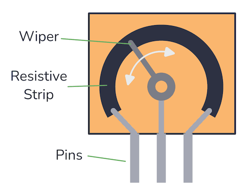

# Lab: Potentiometer
In this lab, you'll connect a potentiometer to your Arduino, read its value, and use it to control an LED.

## 1. Understand the potentiometer
A potentiometer is a variable resistor that allows you to control an electrical signal by turning a knob. Unlike a pushbutton, which has two states (HIGH or LOW), a potentiometer provides a continuous range of values.

A potentiometer has three terminals. The middle terminal is called the wiper and provides a variable voltage as you turn the knob.

## 2. Build the circuit
You will need the following components:
- Arduino Uno R3
- Breadboard
- 10kΩ potentiometer
- LED
- 330Ω resistor
- Jumper wires

### Wiring
| Component |	Arduino connection |
| --- | --- |
| Potentiometer (outer terminal 1)	| 5V |
| Potentiometer (outer terminal 2)	| GND |
| Potentiometer (middle terminal - wiper)	| A0 |
| LED anode (+)	| Digital pin 9  |
| LED cathode (−)  |	GND through 330Ω resistor |

